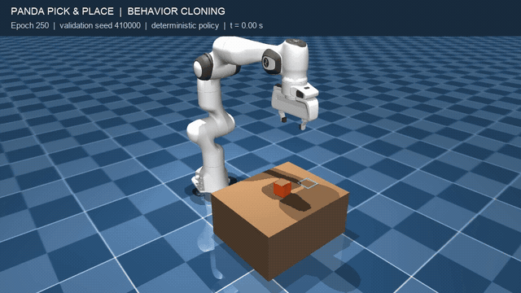
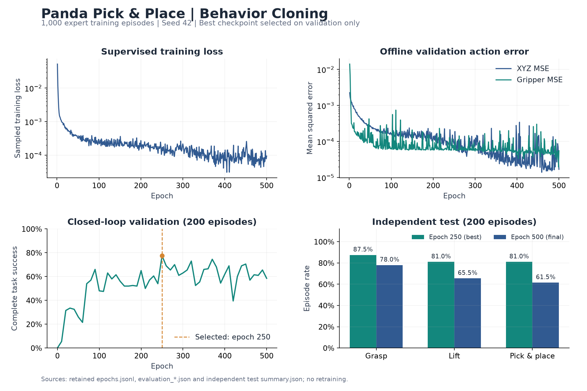
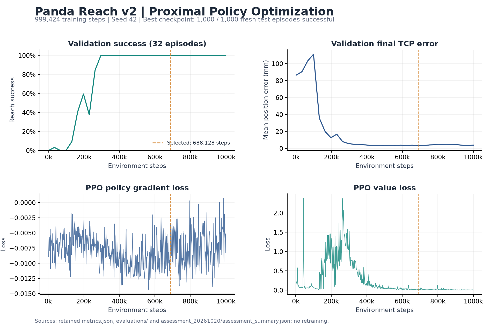

# 基于 MuJoCo 的 Panda 机械臂运动控制与自主抓放

## 项目简介

基于 MuJoCo 与 Franka Panda 七自由度机械臂，构建从运动学求解、底层控制到策略训练与闭环评测的机器人仿真系统。实现基于行为克隆（BC）的自主抓取与放置，以及基于近端策略优化（PPO）的末端到达控制（Reach）。

系统以仿真状态为策略输入，通过笛卡尔增量动作、阻尼最小二乘逆运动学、关节位置控制与夹爪控制驱动机械臂。任务成功依据真实接触、物体支撑、位置误差和持续稳定时间判定。

**主要成果：BC 抓放在独立测试中达到 81.0% 成功率；PPO Reach v2 最佳模型在新增 1000 回合测试中全部成功，平均末态位置误差为 2.965 mm。**

技术栈：Python · MuJoCo · Gymnasium · PyTorch · Stable-Baselines3 · NumPy。

## 一、Pick and Place

完成接近物体、夹持、抬升、搬运、放置、松爪与撤离的完整任务。策略输出 XYZ 增量和夹爪开度，物体运动由接触与动力学产生。完整成功要求物体曾被稳定抬升，最终在目标位置获得桌面支撑，松爪并撤离后仍保持稳定。

### 演示视频

[](docs/media/pick_place_bc.mp4)

[观看或下载完整 MP4 视频](docs/media/pick_place_bc.mp4)

演示使用 BC 最佳模型（epoch 250），固定验证种子为 `410000`，以确定性动作执行，未调用专家。该回合在 346 个控制步、13.84 秒仿真时间内完成；绿色方框标示放置目标，仅用于画面展示。视频按原速播放，首尾增加静帧便于观察。

### BC 结果

使用 **1000 条训练示范 + 200 条验证示范**，分别包含 349396 和 69819 条状态—动作样本。网络输入为 94 维状态，输出为 4 维动作，actor 采用两层 256 单元的 Tanh 网络。仅使用训练集拟合归一化统计并进行监督更新，结合阶段均衡采样，在全部 200 个验证场景上闭环选模，再对固定模型执行独立测试。

| 模型 | 验证集完整成功率 | 独立测试完整成功率 | 测试抓取率 | 测试抬升率 |
| --- | ---: | ---: | ---: | ---: |
| **最佳模型：epoch 250** | **155/200（77.5%）** | **162/200（81.0%）** | **87.5%** | **81.0%** |
| 最终模型：epoch 500 | 117/200（58.5%） | 123/200（61.5%） | 78.0% | 65.5% |

训练、验证、测试种子分别为 `400000–400999`、`410000–410199`、`900000–900199`。最佳模型在测试前由验证集选定，独立测试成功率比最终模型高 19.5 个百分点。最佳模型的 38 个测试失败均为超时。

### 训练与评测可视化



图中展示 500 轮监督训练损失、验证集 XYZ/夹爪动作误差、每 10 轮的闭环验证成功率，以及最佳与最终模型的独立测试结果。离线动作误差持续降低时，闭环成功率仍会波动，因此以闭环验证结果选择模型。

图表来自现存主运行的 `epochs.jsonl`、`evaluation_*.json` 和正式测试 `summary.json`。主模型位于 `outputs/day15_bc_1000_fullval_seed42_500epochs/best_model/epoch_0250/`，正式测试位于 `outputs/day15_bc_fullval_test_20261023/`。

实现入口：[专家与示范采集](training/collect_pick_place_demos.py) · [BC 训练](training/train_bc_pick_place.py) · [闭环评测](training/evaluate_bc_pick_place.py) · [方法与数据说明](notes/03_imitation_learning_bc.md)。

## 二、Reach

通过 PPO 控制机械臂末端到达目标并减速停稳。Reach v2 使用 46 维状态和 XYZ 三维动作，结合选择性观测归一化、重力补偿、近目标低速奖励与 KL 更新约束。控制周期为 0.04 秒，每轴动作增量上限为 5 mm。

### PPO 结果

成功条件为：末端位置误差小于 **9 mm**、姿态误差小于 **0.035 rad**、最大关节速度小于 **0.10 rad/s**，并连续保持 **0.4 秒**。

训练 seed 为 42，总计 **999424 步**；最佳模型由验证集选定，位于 **688128 步**。

| Reach v2 模型 | 测试集 | 成功率 | 平均末态位置误差 | 平均完成时间 |
| --- | --- | ---: | ---: | ---: |
| **最佳模型** | 原 holdout 100 回合 | **100/100（100%）** | **3.146 mm** | 1.194 s |
| 最终模型 | 原 holdout 100 回合 | 100/100（100%） | 4.028 mm | 1.159 s |
| **最佳模型** | 新增 1000 回合 | **1000/1000（100%）** | **2.965 mm** | 1.170 s |
| 最终模型 | 新增 1000 回合 | 1000/1000（100%） | 3.950 mm | 1.137 s |

原 holdout 与新增测试种子分别为 `110000–110099`、`130000–130999`。同批原 holdout 中，随机动作与零动作均为 0/100。以上成绩对应当前任务分布和单个训练 seed。

旧版 Reach v1 使用 94 维观测、4 维动作，五组历史验证最佳模型在同一批 100 个测试场景中的结果如下：

| v1 实验组 | Original | A：选择性归一化 | B：降低初始噪声 | C：近 Home 课程 | D：增强距离成本 |
| --- | ---: | ---: | ---: | ---: | ---: |
| 完整成功率 | 0% | 13% | 4% | 4% | 5% |

v2 同时调整了环境、观测、控制、奖励和优化配置；新旧版本的原始累计奖励不直接比较。

### 训练与评测可视化



图中展示 32 回合验证集的成功率与平均末态位置误差，以及 PPO 策略梯度损失和价值损失。橙色虚线标示验证选出的最佳模型；新增 1000 回合测试用于固定模型后的评测。

图表来自主运行的 `metrics.json` 和 `evaluations/`。主运行位于 `outputs/day14_reach_v2/20261020_115304_reach_v2_seed42_100k_db4ebe/`，最佳模型为其 `best_model/step_000688128/`，正式评测位于 `assessment_20261020/`。

实现入口：[Reach 环境](envs/reach_env.py) · [PPO 训练](training/train_ppo_reach.py) · [模型评测](training/evaluate_ppo_reach.py) · [可视化演示](scripts/42_view_ppo_reach.py) · [算法与实验说明](notes/04_reinforcement_learning_ppo.md)。

## 三、具身智能学习阶段表

| 阶段 | 主题 | 核心内容 | 对应实现与阶段成果 | 统合文档 |
| --- | --- | --- | --- | --- |
| 1 | 具身智能仿真环境 | MuJoCo/MJCF、刚体与关节、执行器、状态读取、物理步与控制步、Gymnasium 接口 | 构建单关节与 Panda 操作环境，定义观测、动作、奖励和终止条件 | [仿真环境](notes/01_simulation_environment.md) |
| 2 | 机器人运动学：正向与逆向运动学 | 位姿与坐标变换、TCP 正向运动学、几何 Jacobian、有限差分验证、DLS 逆运动学 | 实现 `robotics/kinematics.py`、IK 求解与关节跟踪控制，连接笛卡尔目标和机械臂运动 | [机器人运动学](notes/02_robot_kinematics.md) |
| 3 | 具身智能模仿学习：BC | 专家示范、按回合划分数据、训练集归一化、阶段均衡采样、监督训练、闭环选模与独立测试 | 采集 1000/200 条训练/验证示范；最佳抓放策略独立测试成功率 81.0% | [模仿学习 BC](notes/03_imitation_learning_bc.md) |
| 4 | 具身智能强化学习：PPO | 折扣回报、GAE、Actor–Critic、PPO clip、KL 约束、手写实现与 SB3 训练 | 手写 PPO 完成单关节控制；SB3 PPO Reach v2 最佳模型新增测试 1000/1000 成功 | [强化学习 PPO](notes/04_reinforcement_learning_ppo.md) |
| 5 | 具身智能 Pick and Place | 夹爪控制、双侧接触、稳定夹持与抬升、物体偏移补偿、运输、放置、释放与撤离 | 实现规则状态机、示范专家和 BC 闭环抓放，以真实接触及持续稳定条件判定任务完成 | [Pick and Place](notes/05_pick_and_place.md) |

<details>
<summary>本地运行环境（macOS）</summary>

```bash
conda create -n embodied python=3.12 -y
conda activate embodied
python -m pip install -r requirements.txt
```

各任务的模型加载、评测和演示命令见对应统合文档。策略与 `vecnormalize.pkl` 需要配套加载；macOS 交互式 MuJoCo Viewer 使用 `mjpython`。

</details>
